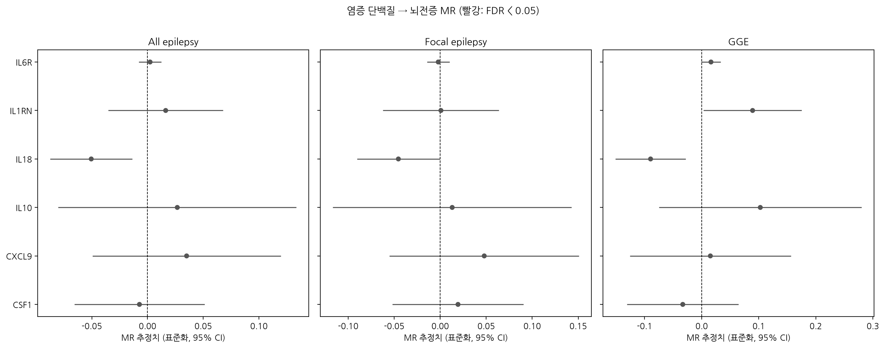

# 염증 단백질 → 뇌전증 2표본 멘델리안 무작위분석

혈중 염증 단백질이 뇌전증의 **원인**인지를 유전 정보로 검증한 2표본 멘델리안 무작위분석(MR) 프로젝트입니다.

뇌전증 환자에서는 IL-1β, IL-6, TNF 같은 염증 물질이 높게 관찰되지만, 관찰 연구만으로는 염증이 뇌전증을 일으키는지, 발작이 염증을 일으키는지 구분할 수 없습니다. 이 프로젝트는 단백질 수치에 영향을 주는 유전 변이를 **자연적인 무작위 배정**으로 활용해 인과 방향을 추정합니다. 염증이 원인으로 확인되면, 이미 다른 질환에 쓰이는 항염증 약물(IL-1 차단제, IL-6 수용체 차단제 등)을 뇌전증에 활용할 근거가 됩니다.

## 연구 질문

1. 유전적으로 예측된 혈중 염증 단백질 수치가 뇌전증 위험에 인과적 영향을 주는가?
2. 그 효과는 뇌전증 아형(국소 뇌전증, 유전성 전신 뇌전증)에 따라 다른가?
3. 기존 사이토카인 MR 연구(*Medicine* 2024)에서 시사된 IL-1Ra, RANTES, M-CSF의 효과가 더 큰 데이터에서도 재현되는가?

## 데이터

| 구분 | 데이터 | 규모 |
|---|---|---|
| 노출 | UK Biobank Pharma Proteomics Project 혈장 단백체 pQTL (Sun 등, *Nature* 2023, 보충표 9) | 유럽인 34,557명, Olink Explore 3072 |
| 결과 | ILAE 복합 뇌전증 컨소시엄 GWAS (Stevelink 등, *Nature Genetics* 2023), 유럽인 전용 요약통계 | 환자 약 3만 명, 대조군 약 5만 명 |

**노출 도구변수 (`mr_data/pqtl_instruments.csv`)**
- 염증 관련 단백질 12개, SNP 56개 (cis 10개, trans 46개)
- 보충표 9의 탐색 코호트 pQTL (p < 1.7×10⁻¹¹, 단백질별 유전 영역마다 대표 SNP 1개)
- 효과 방향은 원표의 A1 대립유전자 기준
- rsID가 없는 trans 삽입·결실 변이 3개는 결과 GWAS와 매칭할 수 없어 제외

| 단백질 | cis | trans | 단백질 | cis | trans |
|---|---|---|---|---|---|
| IL1RN (IL-1Ra) | 1 | 1 | IL18 | 1 | 9 |
| CCL5 (RANTES) | 1 | 9 | GDF15 | 1 | 0 |
| CSF1 (M-CSF) | 1 | 3 | CXCL9 | 1 | 4 |
| IL6R | 1 | 5 | CXCL10 | 1 | 3 |
| TNF | 1 | 2 | IL10 | 1 | 4 |
| IL6 | 0 | 4 | IL1B | 0 | 2 |

IL5와 CRP는 보충표 9에 pQTL이 없어 분석에서 빠졌습니다.

**결과 GWAS**
- [epiGAD](https://www.epigad.org/)에서 공개하는 `final_sumstats.zip` (약 2GB, 별도 신청 불필요)
- 사용 파일: `ILAE3_Caucasian_all_epilepsy`, `ILAE3_Caucasian_focal_epilepsy`, `ILAE3_Caucasian_GGE`

## 분석 방법

1. **도구변수 선별**: p < 5×10⁻⁸, F 통계량 ≥ 10. 주 분석은 **cis-pQTL만** 사용 (단백질 유전자 근처 변이라 다면발현 위험이 낮음)
2. **결과 추출**: zip을 풀지 않고 결과 파일을 청크 단위로 읽어 도구변수 SNP만 추출
3. **대립유전자 정렬**: 효과 대립유전자 방향과 가닥을 맞추고, 빈도로 판단할 수 없는 회문 SNP(A/T, C/G, MAF > 0.42)는 제외
4. **MR 추정**
   - SNP 1개: Wald ratio
   - SNP 2개 이상: IVW (다중 랜덤효과)
   - SNP 3개 이상: MR-Egger, 가중 중앙값, 가중 최빈값 추가
5. **민감도 분석**: Cochran Q(이질성), MR-Egger 절편(방향성 다면발현), Steiger 방향성 검정(역인과), Leave-one-out
6. **다중검정 보정**: Benjamini-Hochberg FDR

모든 MR 방법은 numpy와 scipy로 직접 구현했습니다.

## 결과

### 분석에 포함된 단백질

cis 도구변수가 있는 10개 단백질 중 **6개**(CSF1, CXCL9, IL10, IL18, IL1RN, IL6R)가 결과 GWAS와 매칭되어 분석되었습니다. CCL5, CXCL10, GDF15, TNF는 cis 변이가 결과 GWAS에 없어 제외되었습니다. TNF(빈도 0.1%)와 CXCL10(빈도 0.7%)의 cis 변이는 매우 희귀해 결과 GWAS의 빈도 필터에서 빠진 것으로 보입니다. 모든 단백질이 cis SNP 1개로 분석되어 주 분석은 **Wald ratio**이며, 총 18개 검정(단백질 6개 × 결과 3개)에 FDR 보정을 적용했습니다.

### 주요 결과 (명목 p < 0.1)

| 단백질 | 결과 | β (95% CI) | 근사 OR (95% CI) | p | FDR |
|---|---|---|---|---|---|
| IL18 | GGE | −0.090 (−0.151, −0.028) | 0.84 (0.74, 0.95) | 0.004 | 0.066 |
| IL18 | 전체 뇌전증 | −0.051 (−0.087, −0.014) | 0.90 (0.84, 0.97) | 0.007 | 0.066 |
| IL18 | 국소 뇌전증 | −0.045 (−0.090, −0.0004) | 0.91 (0.83, 1.00) | 0.048 | 0.206 |
| IL1RN | GGE | 0.089 (0.003, 0.175) | 1.20 (1.01, 1.42) | 0.042 | 0.206 |
| IL6R | GGE | 0.016 (−0.001, 0.033) | 1.03 (1.00, 1.07) | 0.057 | 0.206 |

β는 단백질 1 SD 증가당 뇌전증 표준화 효과, 근사 OR은 exp(2β)입니다. 나머지 13개 검정은 모두 p > 0.25였습니다. 전체 결과는 `mr_results/mr_main.csv`에 있습니다.



### 요약

- **FDR < 0.05를 통과한 결과는 없었습니다.**
- **IL-18**은 세 결과 모두에서 명목상 유의한 **위험 감소** 방향을 보였고, 가장 강한 신호는 GGE(p = 0.004, FDR = 0.066)였습니다.
- **IL-1Ra**는 GGE에서만 명목상 유의한 위험 증가 방향을 보였고, 국소 뇌전증에서는 효과가 없었습니다(β = 0.001, p = 0.98).
- **M-CSF(CSF1)**, **IL-10**, **CXCL9**, 그리고 **IL6R**의 전체·국소 뇌전증 결과는 관련성이 없었습니다.
- Steiger 방향성 검정은 모든 조합에서 노출 → 결과 방향을 지지했습니다(노출 설명력이 결과 설명력보다 수백~수만 배 큼).

### 기존 연구와의 비교

기존 사이토카인 MR(*Medicine* 2024)은 IL-1Ra와 M-CSF가 각각 국소 뇌전증과 GGE에 영향을 준다고 보고했으나, 다중검정 보정은 통과하지 못했습니다. 이번 분석에서는
- **IL-1Ra → 국소 뇌전증**: 재현되지 않음 (β = 0.001, p = 0.98)
- **M-CSF → GGE**: 재현되지 않음 (β = −0.033, p = 0.51)
- **RANTES(CCL5)**: cis 변이가 결과 GWAS에 없어 검증하지 못함

더 큰 단백체·뇌전증 데이터와 cis 도구변수로 분석했을 때 기존 신호가 재현되지 않았다는 점은, 기존 결과가 작은 표본과 약한 도구변수에서 나온 우연이었을 가능성을 시사합니다.

## 결론

유전적으로 예측된 혈중 염증 단백질 6종 중 다중검정 보정 후 뇌전증과 유의한 인과 관계를 보인 단백질은 없었습니다. IL-18은 높을수록 뇌전증, 특히 GGE 위험이 낮아지는 방향의 일관된 명목상 신호를 보였으나, 단일 cis 변이에 근거하고 염증성 사이토카인이라는 생물학적 예상과 반대 방향이어서 공동국재 분석 등 추가 검증이 필요합니다.

## 해석 시 주의점

**효과 크기 척도**
ILAE 2023 요약통계의 `Beta`와 `SE`는 직접 추정한 로그 오즈비가 아니라, Z 점수와 대립유전자 빈도, 유효 표본 수로부터 역산한 **표준화 효과 크기**입니다(Zhu 등 2016 공식). 따라서 MR 추정치는 "단백질 1 SD 증가당 뇌전증 표준화 효과"입니다. 코드는 로그 오즈비 ≈ 2 × 표준화 효과로 근사한 OR을 함께 계산하지만, 결과는 **방향과 FDR 보정 p값** 중심으로 해석합니다.

**단일 SNP 결과**
cis-pQTL은 단백질마다 1개뿐이라 주 분석은 대부분 Wald ratio입니다. 다면발현 검정이 불가능하므로 유의한 결과도 "인과 가능성을 시사"하는 수준으로 해석합니다.

**IL-6 신호 경로**
IL-6 자체에는 cis 도구변수가 없고, IL6R 유전자의 cis 변이(rs4129267)를 사용합니다. 이 변이는 혈중 가용성 IL-6 수용체를 높이며, 일반적으로 **IL-6 신호 전달 저하**의 대리 지표로 해석합니다.

**trans 도구변수**
`CIS_ONLY=False`로 바꾸면 trans 변이까지 포함해 IVW와 민감도 분석이 가능합니다. 다만 SH2B3, PTPN22, HLA 영역처럼 여러 면역 질환에 관여하는 변이가 포함되어 다면발현 위험이 크므로 보조 분석으로만 사용합니다.

## 한계

- 노출과 결과 모두 **유럽인 데이터**라 한국인 등 다른 인구에 일반화하기 어렵습니다.
- 혈중 단백질 수치가 **뇌 안의 염증**을 대표하지 못할 수 있습니다.
- 유전 변이는 평생에 걸친 작은 차이를 반영하므로, 약물로 단기간에 크게 바꾸는 효과와 같지 않습니다.
- Olink는 항체 기반 측정이라, 변이가 단백질 양 대신 **항체 결합 부위**를 바꾸는 효과(epitope effect)가 섞일 수 있습니다.
- 노출과 결과 GWAS의 표본 중복 여부는 각 논문의 코호트 목록으로 확인이 필요합니다.

## 향후 과제

- [ ] **IL-18 공동국재 분석(coloc)**: IL-18 cis-pQTL과 뇌전증(GGE) 신호가 같은 인과 변이인지 확인
- [ ] **IL-18 trans 도구변수 포함 분석** (`CIS_ONLY=False`, trans 9개): IVW, MR-Egger, 가중 중앙값으로 방향이 유지되는지 확인
- [ ] CCL5, GDF15 등 결과 GWAS에 없는 변이에 LD 대리 SNP(proxy) 적용
- [ ] 역방향 MR: 뇌전증(전체, GGE) → 염증 단백질
- [ ] 세부 아형 분석: 해마경화증 동반 국소 뇌전증, 청소년 근간대 뇌전증 등
- [ ] R `TwoSampleMR`로 교차 검증

## 실행 방법

### 환경

```bash
pip install pandas numpy scipy matplotlib koreanize-matplotlib
```

Python 3.10 이상에서 동작합니다. Google Colab에서도 실행할 수 있습니다.

### 데이터 준비

1. [epiGAD](https://www.epigad.org/)에서 ILAE 2023 요약통계 `final_sumstats.zip`을 받아 `mr_data/`에 넣습니다. 압축은 풀지 않아도 됩니다.
2. `mr_data/pqtl_instruments.csv`는 저장소에 포함되어 있습니다.

### 실행

```bash
python epilepsy_inflammation_MR_fixed.py
```

결과 파일을 읽는 단계에서 몇 분 정도 걸릴 수 있습니다. 데이터 없이 코드 흐름만 확인하려면 가상 데이터 모드로 실행합니다.

```bash
MR_SYNTHETIC=1 python epilepsy_inflammation_MR_fixed.py          # macOS/Linux
set MR_SYNTHETIC=1 && python epilepsy_inflammation_MR_fixed.py   # Windows
```

### 주요 설정 (코드 상단)

| 변수 | 기본값 | 설명 |
|---|---|---|
| `PROTEINS` | 염증 단백질 14개 | 분석할 단백질 목록 |
| `OUTCOMES` | 전체·국소·GGE | 결과 파일 (세부 아형 추가 가능) |
| `CIS_ONLY` | `True` | cis-pQTL만 사용할지 여부 |
| `P_THRESHOLD` | `5e-8` | 도구변수 유의 기준 |
| `F_MIN` | `10` | 약한 도구변수 기준 |

### 출력 파일 (`mr_results/`)

| 파일 | 내용 |
|---|---|
| `mr_main.csv` | 주 분석(IVW 또는 Wald ratio) 결과, FDR, 근사 OR |
| `mr_all_methods.csv` | 모든 MR 방법의 결과 |
| `mr_sensitivity.csv` | Cochran Q, Egger 절편, Steiger 검정 |
| `forest_all.png` | 전체 결과 forest plot |
| `scatter_loo_*.png` | SNP 3개 이상인 조합의 산점도와 leave-one-out |

### 폴더 구조

```
.
├── epilepsy_inflammation_MR_fixed.py   # 분석 코드
├── README.md
├── mr_data/
│   ├── pqtl_instruments.csv            # 노출 도구변수 (포함)
│   └── final_sumstats.zip              # ILAE 2023 요약통계 (직접 다운로드, 저장소에 올리지 않음)
└── mr_results/                         # 실행 시 자동 생성
```

`final_sumstats.zip`은 용량이 커서 GitHub에 올라가지 않도록 `.gitignore`에 `mr_data/*.zip`을 추가하세요.

## 관련 프로젝트

- 국민건강영양조사(KNHANES) 기반 류마티스관절염 관찰 분석과 2표본 멘델리안 무작위분석
- NHANES 1999–2004 항핵항체(ANA) 양성 예측 모델

## 참고문헌

- Sun BB, et al. Plasma proteomic associations with genetics and health in the UK Biobank. *Nature* 2023;622:329–338. [링크](https://www.nature.com/articles/s41586-023-06592-6)
- Stevelink R, et al. GWAS meta-analysis of over 29,000 people with epilepsy identifies 26 risk loci and subtype-specific genetic architecture. *Nature Genetics* 2023;55:1471–1482. [링크](https://eprints.gla.ac.uk/307631)
- Wang W, et al. Unraveling the links between circulating bioactive factors and epilepsy: a bidirectional Mendelian randomization study. *Medicine* 2024;103(22):e38256. [링크](https://pmc.ncbi.nlm.nih.gov/articles/PMC11142776/)
- Zhu Z, et al. Integration of summary data from GWAS and eQTL studies predicts complex trait gene targets. *Nature Genetics* 2016;48:481–487.
- Bowden J, et al. Consistent estimation in Mendelian randomization with some invalid instruments using a weighted median estimator. *Genetic Epidemiology* 2016;40:304–314.
- Bowden J, et al. Mendelian randomization with invalid instruments: effect estimation and bias detection through Egger regression. *International Journal of Epidemiology* 2015;44:512–525.
